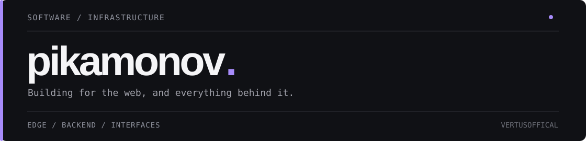

  

  <a href="https://httpddos.ru">Sentinel ↗</a>&nbsp;&nbsp; / &nbsp;&nbsp;
  <a href="https://cloudnw.ru">CloudNetwork ↗</a>&nbsp;&nbsp; / &nbsp;&nbsp;
  <a href="https://t.me/vertusoff">Telegram ↗</a>

 

I build web products and the infrastructure behind them. Most of my work sits somewhere between **backend engineering, networking, security, and interface design**.

I care about performance, predictable behavior, useful observability, and interfaces that make complicated systems feel simple.

### Selected work

<table>
  <tr>
    <td width="50%" valign="top">
      <h3>01 / Sentinel</h3>
      
Application-layer traffic protection and edge infrastructure.

      
Request filtering, TLS fingerprints, challenges, proxy performance, and keeping legitimate traffic moving.

      
<a href="https://httpddos.ru">httpddos.ru ↗</a>

    </td>
    <td width="50%" valign="top">
      <h3>02 / CloudNetwork</h3>
      
VPS / VDS hosting and the systems around it.

      
Provisioning, automation, infrastructure operations, and tools that make managing servers easier.

      
<a href="https://cloudnw.ru">cloudnw.ru ↗</a>

    </td>
  </tr>
</table>

### Tools & technologies

**Languages** &nbsp; TypeScript · JavaScript · Python · PHP · SQL  
**Frontend** &nbsp;&nbsp;&nbsp; React · Tailwind CSS  
**Systems** &nbsp;&nbsp;&nbsp;&nbsp; Linux · Nginx · Docker · HTTP/TLS · WAF · reverse proxies  
**Exploring** &nbsp; Rust · Pingora

---

Build it. Measure it. Find where it breaks. Make it better.

<a href="https://t.me/vertusoff">Get in touch ↗</a>
